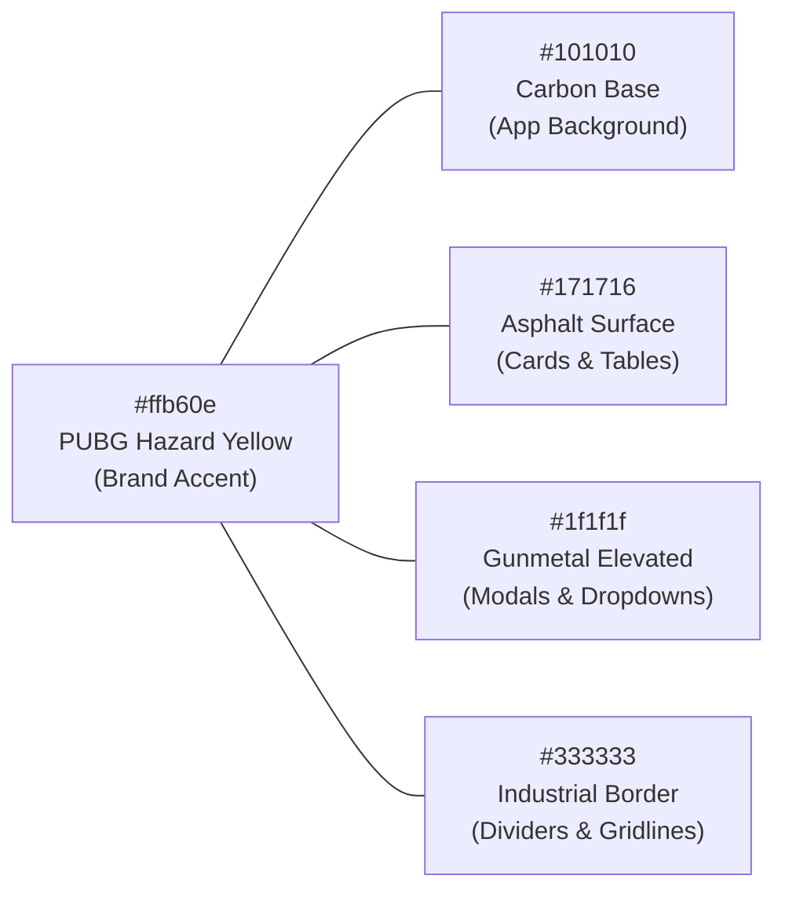

# Official BGMI & PUBG Design System Specification

## 1. Executive Summary & Research Analysis

An exhaustive reverse-engineering of the official web properties:
- **Battlegrounds Mobile India (BGMI)**: [`https://www.battlegroundsmobileindia.com/en`](https://www.battlegroundsmobileindia.com/en)
- **PUBG: Battlegrounds**: [`https://pubg.com/en/main`](https://pubg.com/en/main)

Both properties share Krafton’s unified **Tactical Military Esports** aesthetic. The design is characterized by:
1. **Ultra-Tall, Condensed Military Typography**: Hero headlines, match scores, and CTAs use heavy condensed sans-serifs that mimic military supply crates, tactical weaponry stencils, and arena LED scoreboards.
2. **Iconic Hazard Gold & Carbon Black Palette**: Centered on `--color-brand-pubg-yellow: #ffb60e` set against deep carbon asphalt (`#101010`, `#171716`, `#000000`).
3. **Beveled & Chamfered Polygon Geometry**: Diagonal-cut corners (`clip-path: polygon(...)`), angled tabs, hazard stripes, and high-contrast status badges rather than generic rounded corners.
4. **Dense, Tabular-First Operational Layouts**: Zero decorative whitespace on mission-critical displays; data tables with high contrast, mono-spaced numerical figures, and instant visual validation.

---

## 2. Typography System & Font Hierarchy

The live BGMI and PUBG websites load and utilize three distinct Google & Typekit font families:

```
┌────────────────────────────────────────────────────────────────────────┐
│  PRIMARY DISPLAY & HEADINGS: "Teko"                                    │
│  - Weights: 400 (Regular), 500 (Medium), 600 (Semi-Bold), 700 (Bold)   │
│  - Casing: UPPERCASE ONLY (text-transform: uppercase)                  │
│  - Tracking: Tight (letter-spacing: -0.01em to 0.05em)                 │
│  - Usage: Tournament titles, score ranks, hero banners, action buttons │
├────────────────────────────────────────────────────────────────────────┤
│  SECONDARY & TABULAR DATA: "Roboto Condensed"                          │
│  - Weights: 300 (Light), 400 (Regular), 700 (Bold)                     │
│  - Casing: Natural or Small-Caps                                       │
│  - Characteristics: Tabular numerals (font-variant-numeric: tabular)   │
│  - Usage: Standings tables, kill counters, points, timer clocks, chips │
├────────────────────────────────────────────────────────────────────────┤
│  BODY COPY & FORM CONTROLS: "Noto Sans" / System Sans                  │
│  - Weights: 300 (Light), 400 (Regular), 500 (Medium), 700 (Bold)       │
│  - Usage: Modal copy, help text, input fields, descriptions            │
└────────────────────────────────────────────────────────────────────────┘
```

### Font Loading Code
```html
<link rel="preconnect" href="https://fonts.googleapis.com">
<link rel="preconnect" href="https://fonts.gstatic.com" crossorigin>
<link href="https://fonts.googleapis.com/css2?family=Noto+Sans:wght@300;400;500;700&family=Roboto+Condensed:wght@300;400;700&family=Teko:wght@400;500;600;700&display=swap" rel="stylesheet">
```

### Font Scale Matrix
| Level | Font Family | Size | Weight | Line Height | Usage |
|---|---|---|---|---|---|
| **Display Hero** | `Teko` | `72px – 96px` | 700 Bold | `1.0` | Tournament Title, Major Trophy Banners |
| **Section Title** | `Teko` | `40px – 56px` | 600 SemiBold | `1.1` | Screen Headings (Standings, Matches) |
| **Widget Header** | `Teko` | `28px – 32px` | 600 SemiBold | `1.1` | Card Titles, Modal Headers, Step Indicators |
| **Score Numerals** | `Roboto Condensed` | `20px – 24px` | 700 Bold | `1.0` | Tabular Kill/Placement Points, Ranks |
| **Data Cells & Badges** | `Roboto Condensed` | `13px – 15px` | 500 Medium | `1.2` | Table Cells, Status Chips, Metadata |
| **Interface Body** | `Noto Sans` | `14px – 15px` | 400 Regular | `1.5` | Form Labels, Descriptions, Disclaimers |

---

## 3. Color Token System

Directly extracted from `--color-brand-pubg-yellow` and CSS variables across Krafton’s sites:



### 3.1. Brand Core Colors
- **`--bgmi-gold-primary: #ffb60e`** (The official PUBG/BGMI hazard gold).
- **`--bgmi-gold-hover: #ffc83b`** (Brightened state on hover).
- **`--bgmi-gold-active: #d99800`** (Pressed/active button state).
- **`--bgmi-gold-muted: rgba(255, 182, 14, 0.15)`** (Accent badge backgrounds).

### 3.2. Surface Elevation Architecture
- **Base Canvas**: `#000000` to `#101010` (True Deep Black).
- **Primary Surface / Cards**: `#171716` (Signature Krafton dark charcoal).
- **Elevated Modals & Popovers**: `#1f1f1f` with `border: 1px solid #333333`.
- **Hover Row / Focused Item**: `#262626` / `#2d2d2d`.
- **Dividers & Structural Borders**: `#333333` (subtle) and `#555555` (pronounced).

### 3.3. Esports Status Indicators
- **Chicken Dinner (WWCD)**: `#ffb60e` (Hazard Gold) + `#10b981` (Emerald).
- **Live / Stream Active**: `#06b6d4` (Cyber Cyan) with pulsing dot.
- **Penalty / DQ / Disputed**: `#ef4444` (Crimson Red) with warning border.
- **Verified / Ready**: `#10b981` (High-visibility Emerald).
- **Muted Text**: `#8d8d8d` / `#aaaaaa`.

---

## 4. Tactical Shapes, Borders & Textures

### 4.1. Chamfered Cut Corners (`tactical-cut`)
Instead of rounded pill buttons (`rounded-full` or `rounded-xl`), BGMI uses sharp or angled chamfered cuts:

```css
/* Tactical Chamfer (Top-Right and Bottom-Left Cut) */
.tactical-cut {
  clip-path: polygon(
    0 0,
    calc(100% - 12px) 0,
    100% 12px,
    100% 100%,
    12px 100%,
    0 calc(100% - 12px)
  );
}

/* Tactical Corner Chamfer (Top-Right Only) */
.tactical-cut-tr {
  clip-path: polygon(0 0, calc(100% - 14px) 0, 100% 14px, 100% 100%, 0 100%);
}
```

### 4.2. Inset Industrial Depth & Drop Shadows
```css
/* Signature Krafton button depth */
.tactical-btn-shadow {
  box-shadow: 
    0 4px 8px rgba(0, 0, 0, 0.5),
    inset -2px -2px 0px rgba(0, 0, 0, 0.8),
    inset 1px 1px 2px rgba(255, 255, 255, 0.4);
}
```

### 4.3. Hazard Stripes
Used on live match command banners and urgent dispute alerts:
```css
.tactical-hazard-bar {
  background: repeating-linear-gradient(
    -45deg,
    #ffb60e,
    #ffb60e 12px,
    #000000 12px,
    #000000 24px
  );
}
```

### 4.4. Authentic PUBG Gold Scrollbar
```css
::-webkit-scrollbar {
  width: 8px;
  height: 8px;
}
::-webkit-scrollbar-track {
  background: #111111;
}
::-webkit-scrollbar-thumb {
  background-color: #ffb60e;
  border-radius: 0px;
}
::-webkit-scrollbar-thumb:hover {
  background-color: #ffc83b;
}
```

---

## 5. UI Component Redesign Guidelines

### 5.1. Primary "Play Now" Style CTA Button
- **Background**: Solid `#ffb60e`
- **Text Color**: `#000000` (Strict solid black)
- **Typography**: `font-family: Teko`, `font-size: 24px – 28px`, `font-weight: 600`, `letter-spacing: 0.05em`, `text-transform: uppercase`
- **Hover**: Brightens to `#ffc83b`, subtle scale/lift, crisp outline.

### 5.2. Tactical Card / Table Headers
- Dark Gunmetal `#171716` with a solid `3px solid #ffb60e` left accent bar.
- Category titles in `font-family: Teko` with an amber tag badge (e.g. `[MATCH 03 // LIVE]`).
- Row hover transitions with `#242424` background and amber numeral accents.

### 5.3. 60-Second Fast Score Entry Grid
- Rank 1 (WWCD) highlighted with a luminous gold left border and chicken dinner trophy icon.
- Kills and points rendered with `Roboto Condensed` bold numerals for instantaneous scanning.
- Inline validation error alerts using sharp crimson bevels.

---

## 6. What We Need From You (Assets & Confirmation)

To achieve 100% visual parity with the official BGMI & PUBG portals:

1. **Tournament Brand Assets (Optional)**:
   - Do you have custom logos for your tournament or team organizations? (If not, we will supply high-resolution SVG esports crests).
   - Any custom sponsor badges or banner artwork you'd like included in the header / display overlay?
2. **Minimap / Tactical Map Backgrounds**:
   - Would you like authentic background textures for the four official maps (Erangel military grid, Miramar desert topography, Sanhok rainforest jungle, Vikendi snowy radar)?
3. **Approval to Apply Design Tokens**:
   - Confirming your approval to update `app/globals.css`, `tailwind.config.js`, and `app/layout.tsx` with `Teko` and `Roboto Condensed` and the `#ffb60e` Krafton palette.
