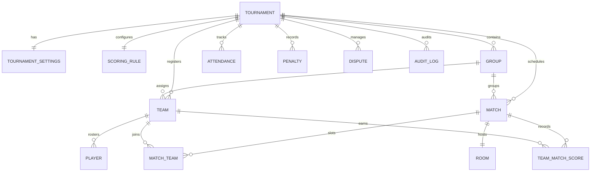

# BGMI Tournament Organizer Platform — Database Contract

## 1. Owner & Scope

- **Exclusive Agent Owner**: **Agent 2 (Database Engineer)**
- **Owned Paths**:
  - `prisma/schema.prisma`
  - `prisma/migrations/**`
  - `prisma/seed.ts`
  - `prisma/seed-data.ts`
  - `lib/db.ts`
  - `lib/seed-service.ts`
  - `docs/database-schema.md`
- **Prohibited Modifications**:
  - Frontend components (`components/**`, `app/**`)
  - API route implementations (`app/api/**`)
  - Scoring engine business math (`lib/scoring/**`)
  - Tournament scheduling algorithms (`lib/tournament/**`)

> ### 🛑 STOP CONDITION
> If completing your task requires modifying a file owned by another agent, DO NOT modify that file. Instead, record the required interface/change in [`/tasks/integration-needed.md`](file:///e:/Github/BGMI%20Brackets/tasks/integration-needed.md), continue working on everything else that is independently possible, and report the dependency.

---

## 2. Core Relational Data Model

The database schema utilizes Prisma ORM with SQLite for local development and zero-config portability, maintaining full compatibility with PostgreSQL for cloud deployments.

### 2.1. Entity Specification

### 2.2. Entity Definitions

1. **User**
   - Fields: `id` (cuid), `name`, `email` (unique), `role` (`SUPER_ADMIN`, `TOURNAMENT_ADMIN`, `MATCH_ADMIN`, `SCOREKEEPER`, `OBSERVER`), `createdAt`, `updatedAt`.
2. **Tournament**
   - Fields: `id` (cuid), `name`, `organizer`, `description`, `format` (`SINGLE_STAGE`, `GROUP_STAGE`, `GROUPS_AND_FINALS`, `QUALIFIERS_AND_FINALS`, `CUSTOM`), `status` (`DRAFT`, `REGISTRATION`, `CHECK_IN`, `GROUPS_LOCKED`, `SCHEDULED`, `LIVE`, `RESULTS_REVIEW`, `COMPLETED`, `ARCHIVED`), `startDate`, `endDate`, `venue`, `contactEmail`, `isFinalized` (Boolean), `finalizedAt` (DateTime).
3. **TournamentSettings**
   - 1:1 with Tournament.
   - Fields: `totalTeamsCap`, `squadSize` (default 4), `substitutesCap` (default 2), `maxTeamsPerGroup` (default 16), `matchDurationMinutes`, `breakDurationMinutes`, `noShowGraceMinutes`, `disputeWindowMinutes`, `allowSubstitutions`, `rulesMarkdown`.
4. **ScoringRule**
   - 1:1 with Tournament. Stores configurable scoring formats (never hardcoded into DB tables).
   - Fields: `name` (e.g. "Official BGIS 10-Point"), `placementPoints` (JSON string mapping rank -> points), `killPointsPerElim` (Float), `wwcdBonus` (Float), `tieBreakers` (JSON array of criteria keys: `WWCD`, `PLACEMENT_POINTS`, `KILL_POINTS`, `BEST_MATCH`, `LAST_MATCH`).
5. **Group**
   - 1:N with Tournament.
   - Fields: `id`, `tournamentId`, `name` ("Group A", "Group B"), `isLocked` (Boolean flag preventing accidental reshuffle on match day).
6. **Team**
   - 1:N with Tournament, optional 1:N with Group.
   - Fields: `name`, `tag` (3-5 chars, e.g. "GODL"), `logoUrl`, `captainName`, `captainPhone`, `captainEmail`, `verificationStatus` (`PENDING`, `VERIFIED`, `REJECTED`), `status` (`ACTIVE`, `DISQUALIFIED`, `WITHDRAWN`).
7. **Player**
   - 1:N with Team.
   - Fields: `name`, `ign` (In-Game Name), `characterId` (BGMI numeric UID), `role` (`CAPTAIN`, `ASSAULTER`, `SNIPER`, `SUPPORT`, `IGL`), `isSubstitute` (Boolean), `isVerified` (Boolean).
8. **Match**
   - 1:N with Tournament, optional 1:N with Group.
   - Fields: `matchNumber` (Int), `title`, `map` (`ERANGEL`, `MIRAMAR`, `SANHOK`, `VIKENDI`), `perspective` (`TPP`, `FPP`), `scheduledStartTime`, `actualStartTime`, `actualEndTime`, `status` (`SCHEDULED`, `READY`, `OPEN`, `LIVE`, `COMPLETED`, `VERIFIED`, `PUBLISHED`, `CANCELLED`), `resultStatus` (`DRAFT`, `SUBMITTED`, `VERIFIED`, `PUBLISHED`).
9. **Room**
   - 1:1 with Match.
   - Fields: `roomName`, `roomId` (in-game custom room ID), `password` (in-game room password), `status` (`NOT_CREATED`, `READY`, `OPEN`, `LIVE`, `COMPLETED`, `CLOSED`).
10. **MatchTeam**
    - Unique composite relation: `@@unique([matchId, teamId])`.
    - Fields: `matchId`, `teamId`, `slotNumber` (1-25).
11. **TeamMatchScore**
    - Unique composite relation: `@@unique([matchId, teamId])`.
    - Fields: `placement` (1-25), `kills` (Int >= 0), `placementPoints`, `killPoints`, `bonusPoints`, `penaltyPoints`, `totalPoints`, `isWwcd`, `notes`.
12. **Attendance**
    - Tracks check-in status: `PRESENT`, `ABSENT`, `LATE`, `DISQUALIFIED`, `WITHDRAWN`.
    - Includes `checkedInBy` staff attribution and `timestamp`.
13. **Penalty**
    - 1:N with Tournament and Team.
    - Fields: `pointsDeducted` (Float), `reason`, `evidenceUrl`, `status` (`ACTIVE`, `VOIDED`), `issuedBy`, timestamps.
14. **Dispute**
    - 1:N with Tournament and Team.
    - Fields: `category` (`SCORING`, `ROSTER`, `BEHAVIOR`, `TECHNICAL`), `description`, `evidenceUrl`, `status` (`OPEN`, `UNDER_REVIEW`, `ACCEPTED`, `REJECTED`, `RESOLVED`), `resolutionNotes`, `resolvedBy`.
15. **AuditLog**
    - Captures state transitions and mutations: `action`, `entityType`, `entityId`, `beforeState` (JSON), `afterState` (JSON), `reason`, `userId`.
16. **Notification**
    - System operational alerts: `title`, `message`, `type` (`INFO`, `SUCCESS`, `WARNING`, `DANGER`), `isRead`.

---

## 3. Strict Database Constraints & Indexing Rules

1. **Player Integrity across Active Teams**:
   - Application & DB queries must enforce that a player's `characterId` does NOT exist in multiple active teams participating in the same tournament.
2. **Match Slot Uniqueness**:
   - `MatchTeam` MUST enforce `@@unique([matchId, teamId])`. A squad cannot be assigned twice to the same match.
3. **Score Sheet Uniqueness**:
   - `TeamMatchScore` MUST enforce `@@unique([matchId, teamId])`. Only one official score entry row per team per match.
4. **Room Exclusivity**:
   - Each match maps to at most one `Room` (`matchId` is `@unique`).
5. **Required Foreign Key Indexes**:
   - Index all lookup relations: `@@index([tournamentId])`, `@@index([groupId])`, `@@index([teamId])`, `@@index([matchId])`.

---

## 4. Seed Architecture Standards

- Seed logic must reside in `lib/seed-service.ts` and `prisma/seed-data.ts`.
- Seeding must be **deterministic and idempotent**:
  - Executing `npx prisma db seed` or calling `/api/demo/seed` must recreate a complete, fully populated mock tournament ("BGMI Pro Invitational 2026") featuring:
    - 1 Tournament with BGIS 10-Point scoring rule.
    - 16 realistic esports squads (GodLike, Team Soul, Global Esports, Revenant, etc.) with 4 starting players + 1 substitute each.
    - 4 Groups (Group A, B, C, D) with seeded distribution.
    - 6 Matches across Erangel, Miramar, Sanhok, Vikendi.
    - Populated room credentials, attendance logs, verified match scores, penalties, and disputes.
