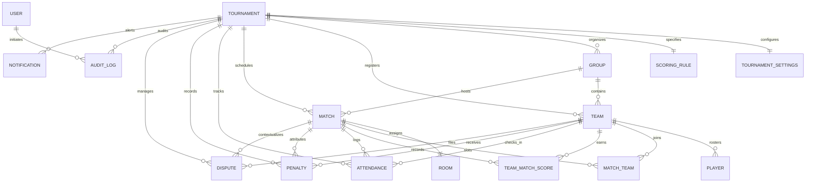

# BGMI Tournament Control Center — Database Schema Specification

## 1. Overview
The database uses a fully normalized relational architecture managed via Prisma ORM. It supports SQLite for rapid zero-dependency local development and deterministic testing, and maintains 100% dialect compatibility with PostgreSQL for enterprise cloud deployments.

- **ORM**: Prisma Client v5.22
- **Dialect**: SQLite (`file:./dev.db`) / PostgreSQL compatible
- **Singleton**: `lib/db.ts` with Next.js HMR protection and connection exhaustion prevention
- **Seed Architecture**: `prisma/seed.ts`, `prisma/seed-data.ts`, and `lib/seed-service.ts`

---

## 2. Entity Relationship Diagram



---

## 3. Data Models Specification

### 3.1 User & Authentication
- **`User`**:
  - `id`: `String` (CUID, `@id`, `@default(cuid())`)
  - `name`: `String`
  - `email`: `String` (`@unique`)
  - `role`: `String` (Default: `"TOURNAMENT_ADMIN"`. Permitted: `SUPER_ADMIN`, `TOURNAMENT_ADMIN`, `MATCH_ADMIN`, `SCOREKEEPER`, `OBSERVER`)
  - `createdAt`: `DateTime` (`@default(now())`)
  - `updatedAt`: `DateTime` (`@updatedAt`)

### 3.2 Tournament & Configuration
- **`Tournament`**:
  - `id`: `String` (CUID, `@id`, `@default(cuid())`)
  - `name`: `String`
  - `organizer`: `String`
  - `description`: `String?`
  - `format`: `String` (Default: `"GROUP_STAGE"`. Permitted: `SINGLE_STAGE`, `GROUP_STAGE`, `GROUPS_AND_FINALS`, `QUALIFIERS_AND_FINALS`, `CUSTOM`)
  - `status`: `String` (Default: `"DRAFT"`. Permitted: `DRAFT`, `REGISTRATION`, `CHECK_IN`, `GROUPS_LOCKED`, `SCHEDULED`, `LIVE`, `RESULTS_REVIEW`, `COMPLETED`, `ARCHIVED`)
  - `startDate`: `DateTime`
  - `endDate`: `DateTime`
  - `venue`: `String?`
  - `contactEmail`: `String?`
  - `isFinalized`: `Boolean` (Default: `false`)
  - `finalizedAt`: `DateTime?`
  - `createdAt`: `DateTime` (`@default(now())`)
  - `updatedAt`: `DateTime` (`@updatedAt`)
  - **Relations**: Cascades on delete to `settings`, `scoringRule`, `groups`, `teams`, `matches`, `attendances`, `penalties`, `disputes`, `auditLogs`, `notifications`.

- **`TournamentSettings`**:
  - `id`: `String` (CUID, `@id`, `@default(cuid())`)
  - `tournamentId`: `String` (`@unique`, Foreign Key -> `Tournament.id`, `onDelete: Cascade`)
  - `totalTeamsCap`: `Int` (Default: `64`)
  - `squadSize`: `Int` (Default: `4`)
  - `substitutesCap`: `Int` (Default: `2`)
  - `maxTeamsPerGroup`: `Int` (Default: `16`)
  - `matchDurationMinutes`: `Int` (Default: `30`)
  - `breakDurationMinutes`: `Int` (Default: `15`)
  - `noShowGraceMinutes`: `Int` (Default: `10`)
  - `disputeWindowMinutes`: `Int` (Default: `15`)
  - `allowSubstitutions`: `Boolean` (Default: `true`)
  - `rulesMarkdown`: `String?`

### 3.3 Scoring Engine Rules
- **`ScoringRule`**:
  - `id`: `String` (CUID, `@id`, `@default(cuid())`)
  - `tournamentId`: `String` (`@unique`, Foreign Key -> `Tournament.id`, `onDelete: Cascade`)
  - `name`: `String` (Default: `"Official BGIS 10-Point System"`)
  - `placementPoints`: `String` (JSON string mapping rank -> points: `{"1":10,"2":6,"3":5,"4":4,"5":3,"6":2,"7":1,"8":1,"9":0,...}`)
  - `killPointsPerElim`: `Float` (Default: `1.0`)
  - `wwcdBonus`: `Float` (Default: `0.0`)
  - `tieBreakers`: `String` (JSON array: `["WWCD","PLACEMENT_POINTS","KILL_POINTS","BEST_MATCH","LAST_MATCH"]`)
  - `createdAt`, `updatedAt`: `DateTime`

### 3.4 Groups
- **`Group`**:
  - `id`: `String` (CUID, `@id`, `@default(cuid())`)
  - `tournamentId`: `String` (Foreign Key -> `Tournament.id`, `onDelete: Cascade`)
  - `name`: `String` (e.g. `"Group A"`, `"Group B"`)
  - `isLocked`: `Boolean` (Default: `false` — guards against accidental reshuffle on match day)
  - `createdAt`, `updatedAt`: `DateTime`
  - **Indexes**:
    - `@@index([tournamentId])`

### 3.5 Teams & Rosters
- **`Team`**:
  - `id`: `String` (CUID, `@id`, `@default(cuid())`)
  - `tournamentId`: `String` (Foreign Key -> `Tournament.id`, `onDelete: Cascade`)
  - `groupId`: `String?` (Foreign Key -> `Group.id`, `onDelete: SetNull`)
  - `name`: `String`
  - `tag`: `String` (3-5 characters, e.g. `"SOUL"`, `"GODL"`)
  - `logoUrl`: `String?`
  - `captainName`: `String?`
  - `captainPhone`: `String?`
  - `captainEmail`: `String?`
  - `verificationStatus`: `String` (Default: `"PENDING"`. Permitted: `PENDING`, `VERIFIED`, `REJECTED`)
  - `status`: `String` (Default: `"ACTIVE"`. Permitted: `ACTIVE`, `DISQUALIFIED`, `WITHDRAWN`)
  - `createdAt`, `updatedAt`: `DateTime`
  - **Indexes**:
    - `@@index([tournamentId])`
    - `@@index([groupId])`

- **`Player`**:
  - `id`: `String` (CUID, `@id`, `@default(cuid())`)
  - `teamId`: `String` (Foreign Key -> `Team.id`, `onDelete: Cascade`)
  - `name`: `String`
  - `ign`: `String` (In-Game Name, e.g. `"Mortal"`, `"Jonathan"`)
  - `characterId`: `String` (BGMI UID, 8-12 numeric characters)
  - `role`: `String` (Default: `"ASSAULTER"`. Permitted: `CAPTAIN`, `ASSAULTER`, `SNIPER`, `SUPPORT`, `IGL`)
  - `isSubstitute`: `Boolean` (Default: `false`)
  - `isVerified`: `Boolean` (Default: `true`)
  - `createdAt`, `updatedAt`: `DateTime`
  - **Indexes**:
    - `@@index([teamId])`
    - `@@index([characterId])` (High-speed roster deduplication and cross-team check)

### 3.6 Matches, Rooms & Slots
- **`Match`**:
  - `id`: `String` (CUID, `@id`, `@default(cuid())`)
  - `tournamentId`: `String` (Foreign Key -> `Tournament.id`, `onDelete: Cascade`)
  - `groupId`: `String?` (Foreign Key -> `Group.id`, `onDelete: SetNull`)
  - `matchNumber`: `Int`
  - `title`: `String` (e.g. `"Match #1 - Erangel (Day 1)"`)
  - `map`: `String` (Default: `"ERANGEL"`. Permitted: `ERANGEL`, `MIRAMAR`, `SANHOK`, `VIKENDI`)
  - `perspective`: `String` (Default: `"TPP"`. Permitted: `TPP`, `FPP`)
  - `scheduledStartTime`: `DateTime`
  - `actualStartTime`: `DateTime?`
  - `actualEndTime`: `DateTime?`
  - `status`: `String` (Default: `"SCHEDULED"`. Permitted: `SCHEDULED`, `READY`, `OPEN`, `LIVE`, `COMPLETED`, `VERIFIED`, `PUBLISHED`, `CANCELLED`)
  - `resultStatus`: `String` (Default: `"DRAFT"`. Permitted: `DRAFT`, `SUBMITTED`, `VERIFIED`, `PUBLISHED`)
  - `createdAt`, `updatedAt`: `DateTime`
  - **Indexes**:
    - `@@index([tournamentId])`
    - `@@index([groupId])`

- **`Room`**:
  - `id`: `String` (CUID, `@id`, `@default(cuid())`)
  - `matchId`: `String` (`@unique`, Foreign Key -> `Match.id`, `onDelete: Cascade`)
  - `roomName`: `String`
  - `roomId`: `String?` (BGMI In-Game Room ID)
  - `password`: `String?` (BGMI In-Game Password)
  - `status`: `String` (Default: `"NOT_CREATED"`. Permitted: `NOT_CREATED`, `READY`, `OPEN`, `LIVE`, `COMPLETED`, `CLOSED`)
  - `updatedAt`: `DateTime` (`@updatedAt`)
  - **Constraint**: Exactly 1 Room per Match via `@unique` constraint on `matchId`.

- **`MatchTeam`**:
  - `id`: `String` (CUID, `@id`, `@default(cuid())`)
  - `matchId`: `String` (Foreign Key -> `Match.id`, `onDelete: Cascade`)
  - `teamId`: `String` (Foreign Key -> `Team.id`, `onDelete: Cascade`)
  - `slotNumber`: `Int?` (Lobby Slot 1-25)
  - **Constraints & Indexes**:
    - `@@unique([matchId, teamId])` (Prevents duplicate team assignment to a single match)
    - `@@index([matchId])`
    - `@@index([teamId])`

### 3.7 Scoring & Standings
- **`TeamMatchScore`**:
  - `id`: `String` (CUID, `@id`, `@default(cuid())`)
  - `matchId`: `String` (Foreign Key -> `Match.id`, `onDelete: Cascade`)
  - `teamId`: `String` (Foreign Key -> `Team.id`, `onDelete: Cascade`)
  - `placement`: `Int` (1 to 25)
  - `kills`: `Int` (Default: `0`)
  - `placementPoints`: `Float` (Default: `0.0`)
  - `killPoints`: `Float` (Default: `0.0`)
  - `bonusPoints`: `Float` (Default: `0.0`)
  - `penaltyPoints`: `Float` (Default: `0.0`)
  - `totalPoints`: `Float` (Default: `0.0`)
  - `isWwcd`: `Boolean` (Default: `false`)
  - `notes`: `String?`
  - `createdAt`, `updatedAt`: `DateTime`
  - **Constraints & Indexes**:
    - `@@unique([matchId, teamId])` (Enforces single official score entry per team per match)
    - `@@index([matchId])`
    - `@@index([teamId])`

### 3.8 Operations & Integrity
- **`Attendance`**:
  - `id`: `String` (CUID, `@id`, `@default(cuid())`)
  - `tournamentId`: `String` (Foreign Key -> `Tournament.id`, `onDelete: Cascade`)
  - `teamId`: `String` (Foreign Key -> `Team.id`, `onDelete: Cascade`)
  - `matchId`: `String?` (Foreign Key -> `Match.id`, `onDelete: SetNull`)
  - `status`: `String` (Default: `"ABSENT"`. Permitted: `PRESENT`, `ABSENT`, `LATE`, `DISQUALIFIED`, `WITHDRAWN`)
  - `checkedInBy`: `String?`
  - `timestamp`: `DateTime` (`@default(now())`)
  - **Indexes**:
    - `@@index([tournamentId])`
    - `@@index([teamId])`
    - `@@index([matchId])`

- **`Penalty`**:
  - `id`: `String` (CUID, `@id`, `@default(cuid())`)
  - `tournamentId`: `String` (Foreign Key -> `Tournament.id`, `onDelete: Cascade`)
  - `teamId`: `String` (Foreign Key -> `Team.id`, `onDelete: Cascade`)
  - `matchId`: `String?` (Foreign Key -> `Match.id`, `onDelete: SetNull`)
  - `pointsDeducted`: `Float`
  - `reason`: `String`
  - `evidenceUrl`: `String?`
  - `status`: `String` (Default: `"ACTIVE"`. Permitted: `ACTIVE`, `VOIDED`)
  - `issuedBy`: `String` (Default: `"Admin"`)
  - `createdAt`, `updatedAt`: `DateTime`
  - **Indexes**:
    - `@@index([tournamentId])`
    - `@@index([teamId])`
    - `@@index([matchId])`

- **`Dispute`**:
  - `id`: `String` (CUID, `@id`, `@default(cuid())`)
  - `tournamentId`: `String` (Foreign Key -> `Tournament.id`, `onDelete: Cascade`)
  - `teamId`: `String` (Foreign Key -> `Team.id`, `onDelete: Cascade`)
  - `matchId`: `String?` (Foreign Key -> `Match.id`, `onDelete: SetNull`)
  - `category`: `String` (Default: `"SCORING"`. Permitted: `SCORING`, `ROSTER`, `BEHAVIOR`, `TECHNICAL`)
  - `description`: `String`
  - `evidenceUrl`: `String?`
  - `status`: `String` (Default: `"OPEN"`. Permitted: `OPEN`, `UNDER_REVIEW`, `ACCEPTED`, `REJECTED`, `RESOLVED`)
  - `resolutionNotes`: `String?`
  - `resolvedBy`: `String?`
  - `createdAt`, `updatedAt`: `DateTime`
  - **Indexes**:
    - `@@index([tournamentId])`
    - `@@index([teamId])`
    - `@@index([matchId])`

- **`AuditLog`**:
  - `id`: `String` (CUID, `@id`, `@default(cuid())`)
  - `tournamentId`: `String?` (Foreign Key -> `Tournament.id`, `onDelete: Cascade`)
  - `userId`: `String?`
  - `action`: `String`
  - `entityType`: `String`
  - `entityId`: `String`
  - `beforeState`: `String?` (JSON)
  - `afterState`: `String?` (JSON)
  - `reason`: `String?`
  - `createdAt`: `DateTime` (`@default(now())`)
  - **Indexes**:
    - `@@index([tournamentId])`
    - `@@index([userId])`
    - `@@index([entityType, entityId])`

- **`Notification`**:
  - `id`: `String` (CUID, `@id`, `@default(cuid())`)
  - `tournamentId`: `String?` (Foreign Key -> `Tournament.id`, `onDelete: Cascade`)
  - `title`: `String`
  - `message`: `String`
  - `type`: `String` (Default: `"INFO"`. Permitted: `INFO`, `SUCCESS`, `WARNING`, `DANGER`)
  - `isRead`: `Boolean` (Default: `false`)
  - `createdAt`: `DateTime` (`@default(now())`)
  - **Indexes**:
    - `@@index([tournamentId])`

---

## 4. Database Client Architecture (`lib/db.ts`)

To avoid connection pool exhaustion during Next.js Hot Module Replacement (HMR) and within serverless function instances, `lib/db.ts` uses the global caching pattern:

```typescript
import { PrismaClient } from '@prisma/client';

const globalForPrisma = globalThis as unknown as {
  prisma: PrismaClient | undefined;
};

export const db =
  globalForPrisma.prisma ??
  new PrismaClient({
    log:
      process.env.NODE_ENV === 'development'
        ? ['warn', 'error']
        : ['error'],
  });

if (process.env.NODE_ENV !== 'production') {
  globalForPrisma.prisma = db;
}

export const prisma = db;

export async function disconnectDb(): Promise<void> {
  await db.$disconnect();
}
```

---

## 5. Deterministic Seed Architecture

The seed architecture ensures zero-regression demo data and end-to-end operational testing:
- **`prisma/seed-data.ts`**: Contains canonical rosters for 16 elite BGMI squads with 4 starters and 1 substitute each (80 players total), all with strictly unique character IDs. Defines 4-group distribution mapping.
- **`lib/seed-service.ts`**: Implements `seedDemoTournament()` and `resetDemoTournament()`.
  - Populates "BGMI Pro Invitational 2026" (`demo_bgmi_pro_invitational_2026`).
  - Configures BGIS 10-Point scoring rule.
  - Distributes 16 teams across 4 locked groups (Group A, B, C, D).
  - Slots 16 teams into 6 sequential matches across Erangel, Miramar, Sanhok, Vikendi.
  - Creates 6 rooms with in-game IDs and passwords.
  - Populates official verified scores for Match 1 & Match 2.
  - Records active penalty for Reckoning Esports and disputes for GodLike and Carnival Gaming.
- **`prisma/seed.ts`**: Standalone executable CLI entry point that resets and seeds the tournament deterministically.
