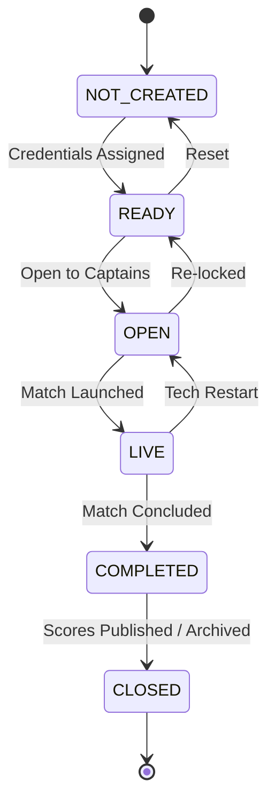
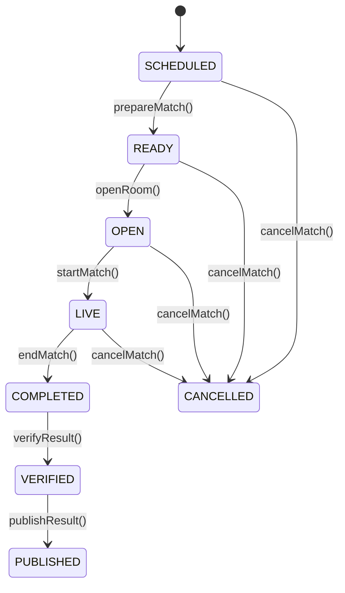

# BGMI Tournament Control Center — Live Match Operations Manual

## 1. Executive Summary & Operational Role

The **BGMI Tournament Control Center (TCC) Operations Engine** (`lib/operations/`) is the live match-day execution core of the platform. Battlegrounds Mobile India (BGMI) presents unique operational complexities distinct from 1v1 tactical esports:
- High-density lobbies with **16 to 25 squads** (up to 100 players) dropped concurrently onto expansive maps.
- Strict coordination of in-game custom room credentials within narrow broadcast time windows.
- Fast turnaround between match conclusion and leaderboard publication (sub-90-second score verification target).
- High tournament stakes requiring tamper-proof score sheets, immutable published results, and a transparent protest desk.

The operations domain services are decoupled, modular, fully typed, provider-neutral, and side-effect-free, allowing robust headless execution, instant unit testing, and straightforward integration with REST API controllers, WebSocket push gateways, and Prisma database persistence.

---

## 2. Operations Service Architecture

```
lib/operations/
├── types.ts              # Operational types, state unions, DTOs, and event envelopes
├── events.ts             # Provider-neutral DomainEventBus & audit log bridge
├── attendance.ts         # Lobby check-in desk, bulk attendance & no-show evaluator
├── room.ts               # Custom room state machine, password concealment & conflict detector
├── match-control.ts      # 5-step match execution pipeline & pre-match checklist
├── result-workflow.ts    # 4-tier score verification, published immutability lock & overrides
├── penalties.ts          # Competitive point deductions & penalty voiding
├── disputes.ts           # Team protest tickets, evidence review & adjudication lifecycle
└── index.ts              # Barrel export for operations domain
```

---

## 3. Lobby Attendance Desk Workflow

### 3.1. Attendance States

Squad attendance operates under 5 mutually exclusive operational states:

| State | Description | Lobby Eligible |
|---|---|---|
| `PRESENT` | Squad captain/roster checked in and ready in custom room slot. | Yes |
| `ABSENT` | Squad has not checked in or reported to lobby marshal. | No |
| `LATE` | Squad reported within the no-show grace window but past deadline. | Yes (Subject to penalty) |
| `WITHDRAWN` | Squad formally withdrew prior to match start. | No |
| `DISQUALIFIED` | Squad disqualified by tournament administration for rule violations. | No |

### 3.2. State Transition Rules & Guards
1. **Disqualified / Withdrawn Lock**: Squads marked `DISQUALIFIED` or `WITHDRAWN` at the team level cannot be checked in as `PRESENT` or `LATE`.
2. **Roster Verification Requirement**: Squads with `verificationStatus === 'REJECTED'` are blocked from lobby check-in.
3. **Operational Reinstatement**: If a team was marked `DISQUALIFIED` for a match, transitioning back to `PRESENT` requires explicit administrative action.

### 3.3. Core Functions (`lib/operations/attendance.ts`)
- `recordAttendance(input, currentStatus?)`: Records attendance for an individual squad, validating state transitions and dispatching domain events (`team.checked_in`, `team.late`, `team.absent`, etc.).
- `bulkCheckIn(input)`: Executes rapid one-click lobby check-in for all active, verified squads while automatically filtering and logging disqualified, withdrawn, or unverified teams.
- `getAttendanceSummary(records, totalCap, allTeams)`: Aggregates latest check-in records, calculates lobby readiness percentage `((present + late) / totalTeams * 100)`, and lists absent/missing squads.
- `evaluateNoShow(scheduledStartTime, gracePeriodMinutes, currentTime)`: Computes elapsed time since match start and determines whether an absent squad has exceeded the grace window (default: 10 minutes).

---

## 4. In-Game Custom Room Lifecycle & Credential Security

### 4.1. Room Lifecycle State Machine



- **`NOT_CREATED`**: Match scheduled, but in-game custom room ID and password not yet generated.
- **`READY`**: Room credentials generated in BGMI client and entered into TCC.
- **`OPEN`**: Credentials displayed to verified team captains via secure captain portals.
- **`LIVE`**: All squads joined their designated slot numbers; match launched in client.
- **`COMPLETED`**: Final squad eliminated; match finished in client.
- **`CLOSED`**: Post-match audit complete; room credentials invalidated.

### 4.2. Password Concealment Protocol
- **Public & Observer Views**: Under `GET /api/matches/[id]/room` and spectator views (`/display`), the room password is obfuscated with `••••••••` (`MASKED_PASSWORD_PLACEHOLDER`) unless the requesting user possesses `canSeeRoomPasswords: true`.
- **Audit Log Redaction**: When logging room entity updates to `AuditLog`, passwords are redacted to `[REDACTED_PASSWORD]` via `sanitizeRoomAuditPayload()`. Room passwords must **never** be stored in cleartext in public audit or telemetry streams.

### 4.3. Custom Room Conflict & Double-Booking Detection
- `detectRoomConflicts(scheduledRooms)`: Iterates over all scheduled matches and identifies if identical in-game `roomId`s are scheduled with overlapping match time intervals (`Math.max(start1, start2) < Math.min(end1, end2)`).
- `validateRoomAssignment(proposedMatch, existingMatches)`: Prevents assigning an in-use custom room to another match until the previous match has concluded.

---

## 5. Match Execution Pipeline

### 5.1. Operational State Transitions



### 5.2. Pre-Match Checklist (`validatePreMatchChecklist`)
Before starting a match, the system verifies:
1. **Slot Integrity**: All slotted squads assigned valid slot numbers (1 to 25).
2. **Zero Duplicate Slots**: No two squads assigned the same slot number.
3. **Minimum Squad Quorum**: At least minimum required squads present (default: 2; recommended: 16).
4. **Room Credentials Configured**: Room ID and Password properly initialized.
5. **Attendance Verification**: Flags squads that have not checked in to the lobby.

### 5.3. The 5 Core Match Operations

1. **`prepareMatch(match)`**: Moves match from `SCHEDULED` to `READY`. Emits `match.ready`.
2. **`openRoom(match, room)`**: Transitions room and match to `OPEN`. Makes credentials available to captains. Emits `match.room_opened`.
3. **`startMatch(match, room, options)`**: Sets `actualStartTime`, transitions match and room to `LIVE`. Emits `match.starting` and `match.live`.
4. **`endMatch(match, room, options)`**: Sets `actualEndTime`, transitions match and room to `COMPLETED`. Emits `match.ended`.
5. **`initiateScoreEntry(match)`**: Validates match is completed and initializes the score sheet in `DRAFT` status ready for tabular input.

---

## 6. 4-Tier Result Verification Workflow

```mermaid
flowchart LR
    A["Tier 1: DRAFT<br/>(Scorekeeper Entry)"] -->|submitMatchResult| B["Tier 2: SUBMITTED<br/>(Lobby Marshal Review)"]
    B -->|verifyMatchResult| C["Tier 3: VERIFIED<br/>(Tournament Admin Confirmation)"]
    C -->|publishMatchResult| D["Tier 4: PUBLISHED<br/>(Leaderboard Locked)"]
    B -->|rejectResult / requestCorrection| A
    C -->|rejectResult| A
    D -.->|overridePublishedResult<br/>(Super Admin Only)| D
```

### 6.1. Tier Breakdown & Permissions

| Tier | Status | Responsible Role | Purpose |
|---|---|---|---|
| **Tier 1** | `DRAFT` | `SCOREKEEPER` | Rapid 16-row score input from in-game result screenshots. |
| **Tier 2** | `SUBMITTED` | `SCOREKEEPER` / `MATCH_ADMIN` | Entered scores audited for mathematical completeness and submitted. |
| **Tier 3** | `VERIFIED` | `TOURNAMENT_ADMIN` | Head admin cross-checks scores against screenshot evidence and confirms validity. |
| **Tier 4** | `PUBLISHED` | `TOURNAMENT_ADMIN` | Scores locked and committed to the cumulative tournament leaderboard. |

### 6.2. Score Sheet Audit Rules (`auditScoreSheet`)
Every score submission, verification, and publication executes strict mathematical checks:
1. **Sequence Continuity**: Placements must form an unbroken sequence from rank 1 to rank N (no missing ranks).
2. **Rank Uniqueness**: Zero duplicate placements (no two squads tied for the same rank in the same match).
3. **WWCD Uniqueness**: Exactly **one** squad must have `placement === 1` (`wwcdCount === 1`).
4. **Non-Negative Kills**: Every squad's kill count must be an integer $\ge 0$.
5. **Slotted Squad Coverage**: Every squad assigned a slot must be accounted for on the score sheet.
6. **Open Disputes Check**: Any unresolved protests filed against the match flag warnings or block publication.

### 6.3. Published Result Immutability Lock
- Once `resultStatus === 'PUBLISHED'`, the match scores are **strictly immutable**.
- Direct edits via `/api/matches/[id]/results` throw `PublishedResultLockedError` (HTTP 409 Conflict).
- **Administrative Override (`overridePublishedResult`)**:
  - Permitted exclusively to `SUPER_ADMIN` or `TOURNAMENT_ADMIN`.
  - Requires a mandatory explanation (`reason` $\ge 5$ chars) stored in `AuditLog`.
  - Dispatches high-priority `result.overridden` event for regulatory auditability.

---

## 7. Penalties & Dispute Resolution Desk

### 7.1. Competitive Deductions (`lib/operations/penalties.ts`)
- **Deduction Rules**: Point deductions must be strictly positive ($> 0$), associated with an active team, and reference a documented rule infraction (min 3 chars) with optional video/screenshot evidence URL.
- **Status Lifecycle**: `ACTIVE` $\rightarrow$ `VOIDED`.
- **Voiding Audits**: Voiding an active penalty requires a formal `voidReason` and staff attribution.
- **Leaderboard Integration**: `calculateNetTeamPenalties(penalties, teamId)` computes active penalty points to be deducted by the scoring engine (`lib/scoring/engine.ts`).

### 7.2. Protest & Dispute Desk (`lib/operations/disputes.ts`)
- **Protest Categories**:
  - `SCORING`: Disputed kill attribution, placement screenshot mismatch.
  - `ROSTER`: Unregistered player, unauthorized substitution, ring-in accusation.
  - `BEHAVIOR`: Toxic chat, griefing, teaming / collusion in lobby.
  - `TECHNICAL`: In-game client disconnect, server crash, room bug.
- **Status Progression**:
  `OPEN` $\rightarrow$ `UNDER_REVIEW` $\rightarrow$ `ACCEPTED` / `REJECTED` $\rightarrow$ `RESOLVED`.
- **Publication Blocker**: `publishMatchResult()` checks `countBlockingDisputes(disputes, matchId)`. Matches with open protests cannot be published until officially adjudicated by tournament referees.

---

## 8. Provider-Neutral Domain Events System

### 8.1. Architecture
`lib/operations/events.ts` implements an in-memory event bus with standardized event envelopes:

```typescript
export interface DomainEventEnvelope<T = unknown> {
  id: string;                                          // e.g. "evt_1727435123_x7a9bc"
  topic: DomainEventTopic;                             // e.g. "match.starting"
  aggregateId: string;                                 // e.g. "m_final_1"
  aggregateType: 'MATCH' | 'TEAM' | 'TOURNAMENT' | 'ROOM' | 'RESULT' | 'PENALTY' | 'DISPUTE';
  timestamp: string;                                   // ISO 8601
  payload: T;
  actorUserId?: string | null;
  version: number;
}
```

### 8.2. Operational Event Catalog

| Domain Topic | Aggregate Type | Trigger Condition |
|---|---|---|
| `match.ready` | `MATCH` | Match pre-flight checks pass; lobby prepared. |
| `match.room_opened` | `MATCH` | In-game room credentials made accessible to captains. |
| `match.starting` | `MATCH` | Custom room countdown begins; match launching. |
| `match.live` | `MATCH` | Match confirmed live; actualStartTime recorded. |
| `match.ended` | `MATCH` | Game client finishes; actualEndTime recorded. |
| `match.cancelled` | `MATCH` | Match abandoned or cancelled by admin. |
| `team.checked_in` | `TEAM` | Squad checked in as `PRESENT`. |
| `team.absent` | `TEAM` | Squad marked `ABSENT` after grace window expires. |
| `team.late` | `TEAM` | Squad checked in during grace window. |
| `team.disqualified` | `TEAM` | Squad disqualified from match or tournament. |
| `attendance.bulk_completed`| `TOURNAMENT` | One-click bulk check-in executed for lobby. |
| `room.opened` | `ROOM` | Room opened for player entry. |
| `room.closed` | `ROOM` | Room decommissioned post-match. |
| `result.draft_saved` | `RESULT` | Scorekeeper initialized draft score sheet. |
| `result.submitted` | `RESULT` | Score sheet submitted for head admin review. |
| `result.rejected` | `RESULT` | Result rejected back to DRAFT with feedback reason. |
| `result.correction_requested`| `RESULT` | Specific cell corrections requested from scorekeeper. |
| `result.verified` | `RESULT` | Head admin verified mathematical and screenshot accuracy. |
| `result.published` | `RESULT` | Result published to live leaderboard; immutability locked. |
| `result.overridden` | `RESULT` | Super Admin overrode published score sheet with audit trail. |
| `penalty.issued` | `PENALTY` | Penalty deduction recorded against squad. |
| `penalty.voided` | `PENALTY` | Penalty voided by head admin. |
| `dispute.created` | `DISPUTE` | Team filed protest ticket. |
| `dispute.status_updated` | `DISPUTE` | Dispute moved to `UNDER_REVIEW`. |
| `dispute.resolved` | `DISPUTE` | Dispute adjudicated (`ACCEPTED`, `REJECTED`, or `RESOLVED`). |

### 8.3. AuditLog & Stream Bridges
- **Prisma AuditLog Bridge**: `domainEventBus.toAuditLogDto(event, reason)` converts any operational event envelope into an entity matching Prisma's `AuditLog` model for instant database recording.
- **WebSocket / SSE Push**: External gateways can subscribe to `domainEventBus.subscribe('*', handler)` to stream operational state changes to live client interfaces.

---

## 9. Pre-Flight Operational Checklist for Lobby Marshals

Before launching any competitive match:
- [ ] **Roster Audit**: All 16-25 squads verified with no duplicate BGMI Character IDs.
- [ ] **Group & Slots**: Each squad assigned a unique slot number between 1 and 25.
- [ ] **Lobby Attendance**: Rapid bulk check-in executed; all squads marked `PRESENT`.
- [ ] **No-Show Resolution**: If any squad is absent, grace period checked; substitutions applied if permitted.
- [ ] **Room Credentials**: In-game room created in BGMI client; Room ID and Password saved in TCC.
- [ ] **Spectator / Observer Guard**: Verify room password is masked on public/broadcast feeds (`••••••••`).
- [ ] **Pipeline Execution**: Execute `prepareMatch` $\rightarrow$ `openRoom` $\rightarrow$ `startMatch`.
- [ ] **Match Concluded**: Execute `endMatch` $\rightarrow$ `initiateScoreEntry`.
- [ ] **Score Verification**: Enter 16 rows $\rightarrow$ `submitResult` $\rightarrow$ `verifyResult` $\rightarrow$ `publishResult`.
- [ ] **Dispute Clearance**: Verify zero blocking disputes before tournament finalization.
