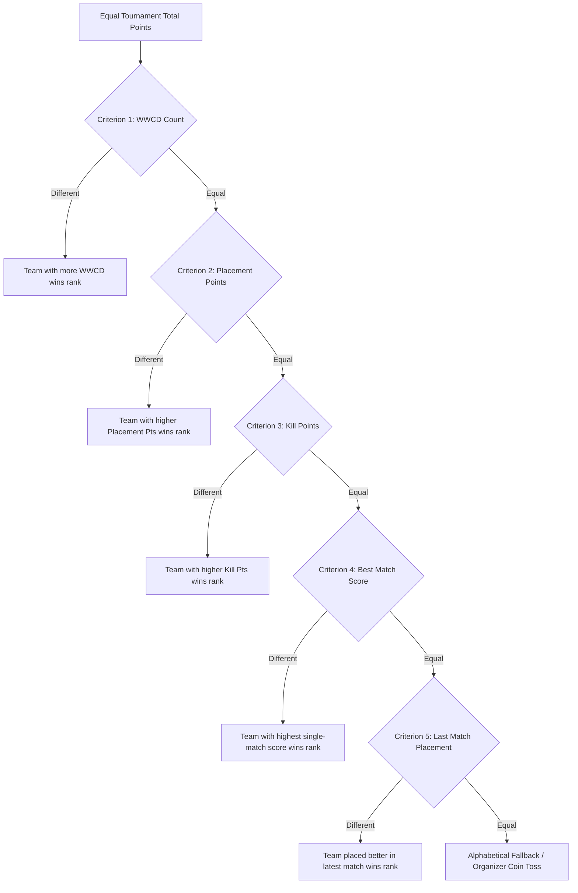

# BGMI Tournament Control Center — Scoring Engine Specification

## 1. Engine Philosophy & Architectural Principles
The BGMI Scoring Engine is a pure, stateless mathematical module completely decoupled from database persistence, HTTP/network transport, and React UI rendering. It can execute identically in Node.js server environments, browser workers, client components, and CLI test harnesses without external dependencies.

- **Primary Module File**: `lib/scoring/engine.ts`
- **Presets File**: `lib/scoring/presets.ts`
- **Types File**: `lib/scoring/types.ts`
- **Unit Test Suite**: `tests/scoring.test.ts`
- **Zero Database Imports**: No Prisma, SQL, or ORM dependencies.
- **Zero React Imports**: Side-effect free pure mathematical functions.
- **Deterministic**: For any identical input tuple `(ScoringRuleConfig, RawTeamMatchInput[], Penalty[])`, the calculated outputs and rankings are 100% identical every time.

---

## 2. Core Mathematical Formulas

### 2.1. Match-Level Scoring
For each team in a completed match:

$$\text{Placement Points} = \text{placementPoints}[\text{placement}] \;\; (\text{or } 0 \text{ if unranked})$$

$$\text{Kill Points} = \text{kills} \times \text{killPointsPerElim}$$

$$\text{Bonus Points} = \text{bonusPoints} + \begin{cases} \text{wwcdBonus}, & \text{if } \text{placement} = 1 \\ 0, & \text{otherwise} \end{cases}$$

$$\text{Match Total Points} = \max(0, \text{Placement Points} + \text{Kill Points} + \text{Bonus Points} - \text{penaltyPoints})$$

*(If `rule.allowNegativeScores = true`, the clamping function $\max(0, \dots)$ is bypassed).*

### 2.2. Cumulative Tournament Standings
For each team across all played matches:

$$\text{Tournament Placement Points} = \sum_{m \in \text{Matches}} \text{Placement Points}_m$$

$$\text{Tournament Kill Points} = \sum_{m \in \text{Matches}} \text{Kill Points}_m$$

$$\text{Tournament Bonus Points} = \sum_{m \in \text{Matches}} \text{Bonus Points}_m$$

$$\text{Total Deductions} = \sum_{m \in \text{Matches}} \text{penaltyPoints}_m + \sum_{p \in \text{Active Penalties}} \text{pointsDeducted}_p$$

$$\text{Tournament Total Points} = \max(0, \text{Tournament Placement Points} + \text{Tournament Kill Points} + \text{Tournament Bonus Points} - \text{Total Deductions})$$

---

## 3. Official Scoring Presets

The engine includes official presets conforming to BGMI competitive esports regulations:

### 3.1. Official BGIS 10-Point System (`BGIS_10_POINT_SYSTEM`)
The standard tournament format for Battlegrounds Mobile India Series (BGIS 2024 / 2025):
- **1st (WWCD)**: 10 pts
- **2nd**: 6 pts
- **3rd**: 5 pts
- **4th**: 4 pts
- **5th**: 3 pts
- **6th**: 2 pts
- **7th**: 1 pt
- **8th**: 1 pt
- **9th – 16th+**: 0 pts
- **Kill Multiplier**: 1.0 pt per elimination
- **WWCD Bonus**: 0.0 pts (built into the 10 placement points)
- **Tie-Breakers**: `['WWCD', 'PLACEMENT_POINTS', 'KILL_POINTS', 'BEST_MATCH', 'LAST_MATCH']`

### 3.2. BMPS 15-Point System (`BMPS_15_POINT_SYSTEM`)
The SUPER-derived scoring system utilized in BGMI Pro Series (BMPS):
- **1st (WWCD)**: 15 pts
- **2nd**: 12 pts
- **3rd**: 10 pts
- **4th**: 8 pts
- **5th**: 6 pts
- **6th**: 4 pts
- **7th**: 2 pts
- **8th – 12th**: 1 pt each
- **13th – 16th+**: 0 pts
- **Kill Multiplier**: 1.0 pt per elimination
- **WWCD Bonus**: 0.0 pts
- **Tie-Breakers**: `['WWCD', 'PLACEMENT_POINTS', 'KILL_POINTS', 'BEST_MATCH', 'LAST_MATCH']`

### 3.3. Classic PMCO 20-Point System (`PMCO_20_POINT_SYSTEM`)
The classic 20-point PUBG Mobile Club Open (PMCO) format:
- **1st (WWCD)**: 20 pts
- **2nd**: 14 pts
- **3rd**: 10 pts
- **4th**: 8 pts
- **5th**: 7 pts
- **6th**: 6 pts
- **7th**: 5 pts
- **8th**: 4 pts
- **9th**: 3 pts
- **10th**: 2 pts
- **11th – 16th**: 1 pt each
- **17th+**: 0 pts
- **Kill Multiplier**: 1.0 pt per elimination
- **WWCD Bonus**: 0.0 pts
- **Tie-Breakers**: `['WWCD', 'PLACEMENT_POINTS', 'KILL_POINTS', 'BEST_MATCH', 'LAST_MATCH']`

### 3.4. Custom Scoring Rules (`createCustomScoringRule`)
Tournament organizers can configure custom point distributions, non-standard kill multipliers (e.g. 2.0x for blitz phases), WWCD victory bonuses, and customized tie-breaker priorities.

---

## 4. Multi-Tier Configurable Tie-Breaker Engine

When two or more teams achieve identical cumulative `totalPoints`, the scoring engine sequentially evaluates the configured `tieBreakers` array:

### 4.1. Supported Criteria Specifications
1. **`WWCD`**: Highest total Chicken Dinners (1st place finishes).
2. **`PLACEMENT_POINTS`**: Highest cumulative placement points earned across all matches.
3. **`KILL_POINTS`**: Highest cumulative kill points earned across all matches.
4. **`BEST_MATCH`**: Highest total score achieved in a single match.
5. **`LAST_MATCH`**: Better placement (lower numeric rank) in the most recent chronologically completed match.

### 4.2. Automatic `tieBreakReason` Annotation
When teams tie on points, the engine sets `tieBreakReason` on each affected team's `CumulativeTeamStanding`:
- **Winner Example**: `"Higher WWCD (2 vs 1)"`
- **Placement Example**: `"Higher Placement Points (16 vs 15)"`
- **Kill Example**: `"Higher Kill Points (12 vs 10)"`
- **Best Match Example**: `"Higher Best Match Score (22 vs 18)"`
- **Last Match Example**: `"Better Last Match Placement (#2 vs #5)"`
- **Unbroken Tie**: `"Tied on all criteria (alphabetical)"`

---

## 5. Penalties, Bonuses, Disqualifications & Edge Cases

### 5.1. General & Match-Level Penalties
- **Match-Level**: Input via `RawTeamMatchInput.penaltyPoints`. Deducted during single-match score computation.
- **Tournament-Level**: Input via `GeneralPenaltyInput[]` (e.g. late check-in, behavior infractions). Penalties with `status === 'ACTIVE'` (or undefined status) are deducted from cumulative totals. Penalties with `status === 'VOIDED'` are safely ignored.
- **Score Floor**: Total points are clamped to $\ge 0$ unless `allowNegativeScores` is explicitly enabled.

### 5.2. Match & Tournament Bonuses
- **Match-Level Bonus**: Arbitrary bonus points allocated to a team for specific match events.
- **WWCD Victory Bonus**: Defined via `rule.wwcdBonus`, automatically awarded only to the 1st place finisher.

### 5.3. Disqualifications (DQ)
- **Match-Level DQ (`isDisqualified: true`)**:
  - Placement and kill points zeroed for that specific match.
  - `isWwcd` forced to `false`.
  - Score notes flagged with `"(Disqualified)"`.
- **Tournament-Level DQ (`status: 'DISQUALIFIED'`)**:
  - Regardless of points accumulated, disqualified teams are relegated to the bottom of the tournament leaderboard.
  - Active teams are always ranked above disqualified teams.
  - If multiple teams are disqualified, they are ranked amongst themselves at the bottom by points/tie-breakers.
  - Flagged with `isDisqualified: true`, `status: 'DISQUALIFIED'`, and `tieBreakReason: 'Disqualified from tournament'`.

### 5.4. Irregular Match Data
- **0 Kills & 0 Placement Points**: Properly scores 0 total points without NaN or runtime exceptions.
- **Partial Lobbies**: Lobbies with fewer than 16 squads (e.g. 12 or 14 teams due to no-shows) are accepted with an informational warning.
- **Lobby Participation Cap**: Matches with more than 25 squads (>100 players) are rejected by input validation.
- **Unregistered Teams in Match**: The engine dynamically registers any team ID appearing in match sheets into the leaderboard without throwing exceptions.

---

## 6. Input Validation API

Pure validation function: `validateMatchScores(inputs: RawTeamMatchInput[], expectedTeamsCount?: number): ScoringValidationResult` (aliased as `validateMatchScoreInputs`).

Enforces:
1. **Non-Empty Payload**: Rejects empty score submissions.
2. **Team Identity**: Every row must specify a non-empty `teamId`.
3. **Team Uniqueness**: Rejects duplicate entries for the same team in a match.
4. **Placement Range**: Ranks must be integers between 1 and 25 (`Must be 1 or greater`).
5. **Placement Uniqueness**: No two teams may occupy the same placement rank in a match.
6. **Non-Negative Kills**: Kills must be a non-negative integer ($\ge 0$).
7. **Lobby Participation Cap**: Matches cannot exceed 25 squads.
8. **Sanity Warnings**: Flags unusually high kill counts ($> 60$) and lobbies smaller than `expectedTeamsCount`.

---

## 7. Engine API Reference

| Function | Signature | Description |
|---|---|---|
| `validateMatchScores` | `(inputs: RawTeamMatchInput[], expectedTeamsCount?: number) => ScoringValidationResult` | Validates raw match score submissions against BGMI rules. |
| `calculateSingleTeamScore` | `(input: RawTeamMatchInput, rule: ScoringRuleConfig) => CalculatedTeamMatchScore` | Computes placement, kills, bonuses, penalties, and net points for one squad. |
| `calculateMatchScores` | `(inputs: RawTeamMatchInput[], rule: ScoringRuleConfig) => CalculatedTeamMatchScore[]` | Computes all scores for a match, sorted by placement ascending. |
| `calculateTournamentLeaderboard` | `(teams, matchScores, penalties?, rule?) => CumulativeTeamStanding[]` | Core aggregation function generating full tournament standings with multi-tier tie-breakers. |
| `calculateStandings` | `(rule, matchScores, penalties?, teams?) => CumulativeTeamStanding[]` | Standard contract alias supporting both `(rule, matchScores, ...)` and `(teams, matchScores, ...)`. |
| `getScoringPreset` | `(presetKey: string) => ScoringRuleConfig` | Fetches a standard preset by key with fallback to BGIS 10-Point. |
| `createCustomScoringRule` | `(params: Partial<ScoringRuleConfig> & { name: string }) => ScoringRuleConfig` | Factory for creating validated custom scoring rules. |

---

## 8. Verification & Quality Assurance

- **Unit Test File**: `tests/scoring.test.ts`
- **Total Test Cases**: 45 exhaustive unit tests.
- **Coverage Areas**:
  - BGIS 10-Point, BMPS 15-Point, PMCO 20-Point calculations
  - Placement points from 1st to 25th
  - Kill multiplier scaling and 0-kill matches
  - Match penalties and tournament penalties
  - Clamping to 0 and optional negative scores
  - WWCD bonus point assignment
  - Input validation error detection and warning thresholds
  - 5-Tier Tie-Breaker Resolution (WWCD $\to$ Placement Pts $\to$ Kill Pts $\to$ Best Match $\to$ Last Match)
  - Custom tie-breaker priority reordering
  - Match-level and Tournament-level disqualifications
  - Determinism verification across repetitive executions
  - Overloaded function contract signatures
