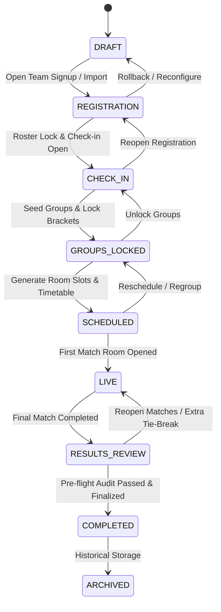
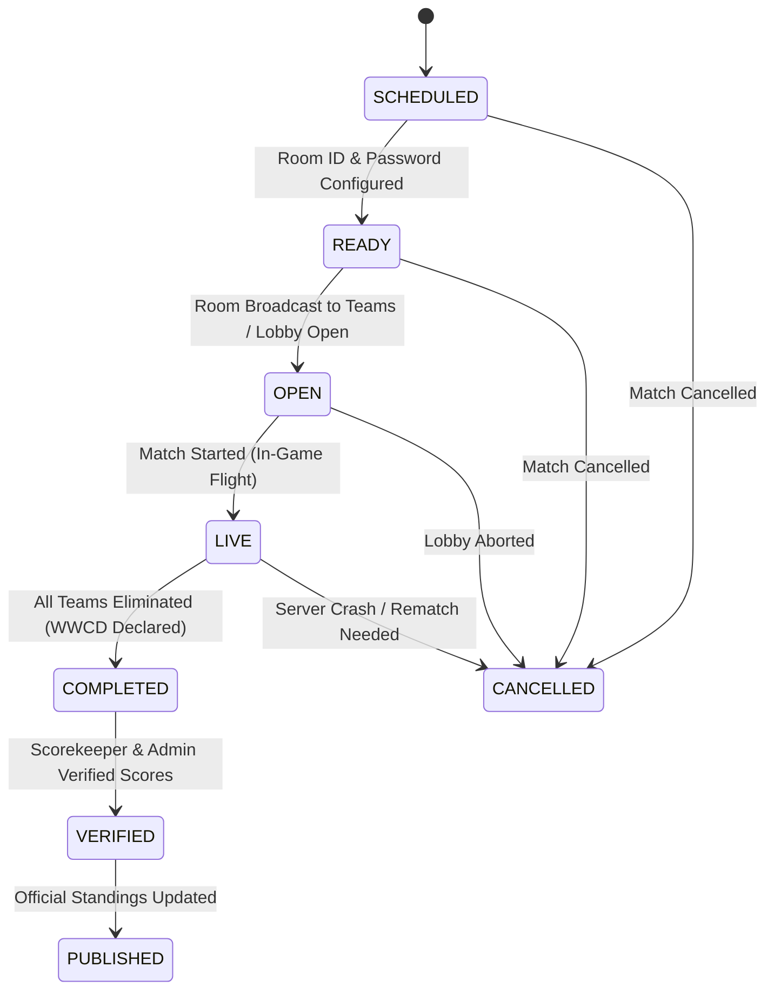

# BGMI Tournament Control Center — Tournament Engine Specification

## 1. Overview & Core Responsibilities

The **Tournament Engine** (`lib/tournament/engine.ts`) is the operational coordination and scheduling core of the **BGMI Tournament Control Center (TCC)**. It executes pure mathematical and deterministic business logic for tournament logistics, completely decoupled from database I/O and UI presentation:

1. **Deterministic Seeded Group Distribution & Balancing**: Distributes participating squads evenly across group brackets using a deterministic Mulberry32 pseudo-random number generator (PRNG) with strict group locking enforcement.
2. **Sequential Match Schedule Generator**: Generates conflict-free match timetables with automatic rotation across standard BGMI battle royale maps (`ERANGEL`, `MIRAMAR`, `SANHOK`, `VIKENDI`) incorporating match play durations and intermission breaks.
3. **Multi-Vector Conflict & Concurrency Detector**: Detects room double-bookings, team concurrency collisions (same team scheduled in multiple matches simultaneously), group concurrency collisions, and invalid time parameters.
4. **Tournament Lifecycle State Machine**: Governs the 9-stage operational lifecycle from `DRAFT` to `ARCHIVED`, preventing illegal status jumps and enforcing strict operational guards.
5. **Match Operations State Machine**: Orchestrates individual match lifecycle states from `SCHEDULED` through `PUBLISHED`.
6. **Pre-Flight Finalization Audit**: Comprehensive pre-flight readiness checklist validating 100% match completion, result verification, dispute resolution, active team thresholds, and penalty/tie-breaker integrity before locking official results.

---

## 2. Seeded Group Distribution & Balancing

### 2.1. Deterministic Mulberry32 PRNG
To ensure tournament seeding is strictly reproducible and auditable, the engine implements a deterministic Mulberry32 pseudo-random number generator. Given identical team arrays and seeds (e.g., `seed: 42`), the engine generates identical group allocations:

```typescript
function pseudoRandom(seed: number): () => number
function shuffleArray<T>(array: T[], seed?: number): T[]
```

### 2.2. Even & Remainder Group Balancing
Teams are partitioned round-robin after shuffling across `N` groups:
- 16 squads across 4 groups -> 4 squads per group (`4-4-4-4`).
- 17 squads across 3 groups -> 6 squads in groups A and B, 5 squads in group C (`6-6-5`).

### 2.3. Group Locking Protection (`isLocked`)
Once an organizer locks groups (`isLocked: true` or any group entry has `isLocked: true`), automated reshuffle and randomization calls are blocked by throwing an explicit operational error:
```typescript
if (isLocked || groups?.some(g => g.isLocked)) {
  throw new Error('Cannot randomize teams while groups are locked. Unlock them first.');
}
```

---

## 3. Match Timetable Generation & Map Rotation

### 3.1. Standard Map Rotation
Standard BGMI esports matches follow a 4-map rotation:
`ERANGEL` ➔ `MIRAMAR` ➔ `SANHOK` ➔ `VIKENDI`

When scheduling more than 4 matches, the generator loops seamlessly across standard or custom map sequences.

### 3.2. Sequential Time Slot Calculation
Match timestamps are calculated using:
$$\text{Scheduled Start Time}(i) = \text{Base Start Time} + i \times (\text{Match Duration} + \text{Break Duration})$$

```typescript
export function generateMatchSchedule(
  options: ScheduleGenerationOptions
): GeneratedMatchSlot[]
```

Options:
- `tournamentId: string`: Target tournament ID.
- `matchCount: number`: Total matches to schedule.
- `startTime: Date`: Opening match start timestamp.
- `matchDurationMinutes: number`: Anticipated gameplay duration (e.g. 30–35 min).
- `breakDurationMinutes: number`: Intermission / broadcast buffer (e.g. 10–15 min).
- `maps?: GameMapName[]`: Custom map array or defaults to `STANDARD_BGMI_MAPS`.
- `groupIds?: string[]`: Optional group rotation round-robin IDs.
- `perspective?: 'TPP' | 'FPP'`: Default `'TPP'`.

---

## 4. Multi-Vector Conflict & Concurrency Detection

The engine detects operational conflicts across time intervals $[T_{\text{start}}, T_{\text{start}} + \text{Duration})$:

```typescript
export function detectMatchConflicts(
  matches: MatchConflictInput[],
  options?: ConflictCheckOptions
): ConflictCheckResult
```

### Conflict Checks:
1. **Room Double-Booking**: Flags any two matches sharing the same `roomId` whose scheduled time windows overlap:
   $$\max(S_1, S_2) < \min(E_1, E_2)$$
2. **Team Concurrency Collision**: Flags when a team (`teamId`) is rostered in two matches scheduled during overlapping time windows.
3. **Group Concurrency Collision**: Flags when the same `groupId` is scheduled in two concurrent matches.
4. **Time Validity**: Rejects matches with invalid `scheduledStartTime` (`NaN`), non-positive durations ($\le 0$), or start times in the past (when `checkPastTimes: true`).

---

## 5. Tournament Lifecycle State Machine



### 5.1. Transition Guards & Operational Rules

| Current Stage | Target Stage | Guard Condition / Validation |
|---|---|---|
| `DRAFT` | `REGISTRATION` | Basic tournament settings and format configured. |
| `REGISTRATION` | `CHECK_IN` | Minimum participating teams reached (default: $\ge 16$ teams). |
| `CHECK_IN` | `GROUPS_LOCKED` | Groups configured and all participating teams distributed. |
| `GROUPS_LOCKED` | `SCHEDULED` | All groups locked (`isLocked: true`). |
| `SCHEDULED` | `LIVE` | Rooms initialized with scheduled maps and start timestamps. |
| `LIVE` | `RESULTS_REVIEW` | All live matches concluded. |
| `RESULTS_REVIEW` | `COMPLETED` | **Pre-flight finalization audit passed** (`canFinalize === true`). |
| `COMPLETED` | `ARCHIVED` | Tournament officially closed, standings locked permanently. |
| `ARCHIVED` | *None* | Terminal state. No further transitions permitted. |

### 5.2. State Machine Functions
- `isValidTournamentTransition(from, to): boolean`
- `validateTournamentTransition(from, to, context?): StateTransitionResult`
- `getNextAllowedTournamentStatuses(from): TournamentStatus[]`

---

## 6. Match Operations State Machine



### Match Transition Functions:
- `isValidMatchTransition(from, to): boolean`
- `validateMatchTransition(from, to): MatchStateTransitionResult`
- `getNextAllowedMatchStatuses(from): MatchOperationalStatus[]`

---

## 7. Pre-Flight Finalization Audit

Before a tournament can transition to `COMPLETED`, the engine executes an exhaustive checklist audit:

```typescript
export function auditTournamentFinalization(
  paramsOrId: string | FinalizationAuditParams,
  maybeParams?: FinalizationAuditParams
): FinalizationAuditResult
```

### Audit Checklist Items:
1. `matches_complete`: $100\%$ of scheduled matches completed ($\text{completed} \ge \text{total} > 0$).
2. `results_verified`: $100\%$ of match scores verified and published ($\text{verified} \ge \text{total} > 0$).
3. `disputes_resolved`: Zero open or under-review disputes remaining ($\text{openDisputes} = 0$).
4. `active_teams`: At least 2 active participating teams present.
5. `penalties_confirmed`: All penalty deductions officially confirmed ($\text{unconfirmedPenalties} = 0$).
6. `tiebreakers_resolved`: All ranking ties resolved via official tie-breaking rules.

If any check fails, `canFinalize` is returned as `false` with detailed diagnostics for each failing checklist item.

---

## 8. Exported API Reference

```typescript
// Seeded PRNG & Shuffling
export function pseudoRandom(seed: number): () => number;
export function shuffleArray<T>(array: T[], seed?: number): T[];

// Groups
export function distributeTeamsToGroups(options: GroupGenerationOptions): Map<number, Array<{ id: string; name: string }>>;
export function generateBalancedGroups(options: GroupGenerationOptions): BalancedGroup[];

// Scheduling & Conflict Detection
export function generateMatchSchedule(options: ScheduleGenerationOptions): GeneratedMatchSlot[];
export function detectMatchConflicts(matches: MatchConflictInput[], options?: ConflictCheckOptions): ConflictCheckResult;
export const detectSchedulingConflicts: typeof detectMatchConflicts;

// Tournament Lifecycle State Machine
export function isValidTournamentTransition(currentStatus: TournamentStatus, nextStatus: TournamentStatus): boolean;
export function validateTournamentTransition(currentStatus: TournamentStatus, nextStatus: TournamentStatus, context?: TournamentTransitionContext): StateTransitionResult;
export function getNextAllowedTournamentStatuses(currentStatus: TournamentStatus): TournamentStatus[];

// Match Operations State Machine
export function isValidMatchTransition(currentStatus: MatchOperationalStatus, nextStatus: MatchOperationalStatus): boolean;
export function validateMatchTransition(currentStatus: MatchOperationalStatus, nextStatus: MatchOperationalStatus): MatchStateTransitionResult;
export function getNextAllowedMatchStatuses(currentStatus: MatchOperationalStatus): MatchOperationalStatus[];

// Finalization Pre-Flight Audit
export function auditTournamentFinalization(paramsOrId: string | FinalizationAuditParams, maybeParams?: FinalizationAuditParams): FinalizationAuditResult;
```
