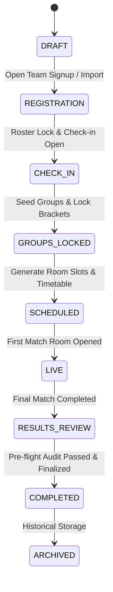
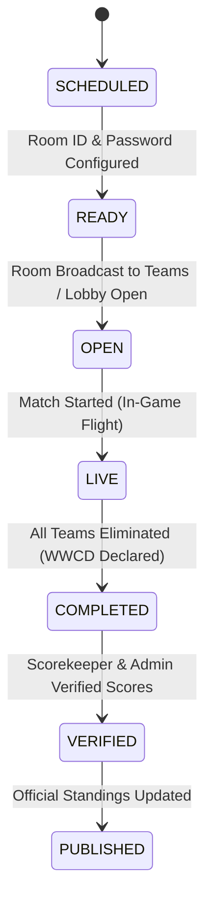

# BGMI Tournament Control Center — Tournament Engine Specification

## 1. Responsibilities
The Tournament Engine coordinates all structural and operational state transitions:
1. Tournament lifecycle state machine.
2. Group generation, seeded randomization, balancing, and locking.
3. Match scheduling with conflict detection (no double-booked rooms or teams playing concurrently).
4. Room lifecycle and credential distribution.
5. Finalization pre-flight audit checklist.

## 2. Tournament Lifecycle State Machine

### Transition Guards:
- `REGISTRATION` -> `CHECK_IN`: At least 16 teams registered and verified.
- `CHECK_IN` -> `GROUPS_LOCKED`: Groups configured and balanced.
- `GROUPS_LOCKED` -> `SCHEDULED`: Group team count matches room lobby capacities.
- `SCHEDULED` -> `LIVE`: Rooms initialized with maps and start timestamps.
- `RESULTS_REVIEW` -> `COMPLETED`: 100% of matches verified; 0 open disputes; 0 unverified scores.

## 3. Match Operations State Machine

## 4. Conflict & Concurrency Prevention
- **Room Conflict Check**: A room cannot be scheduled for two concurrent matches within the `matchDurationMinutes + breakDurationMinutes` window.
- **Team Concurrency Check**: A team cannot be rostered into two matches occurring in overlapping time slots.
- **Locked Group Guard**: Once a group is marked `isLocked: true`, automated reshuffle/randomize calls are blocked unless explicitly unlocked by an Admin.
